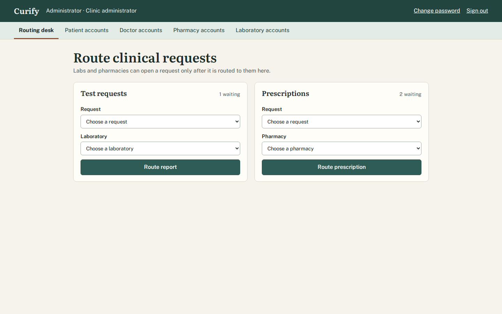
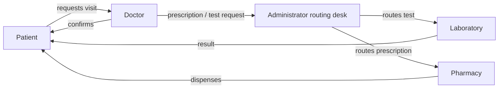
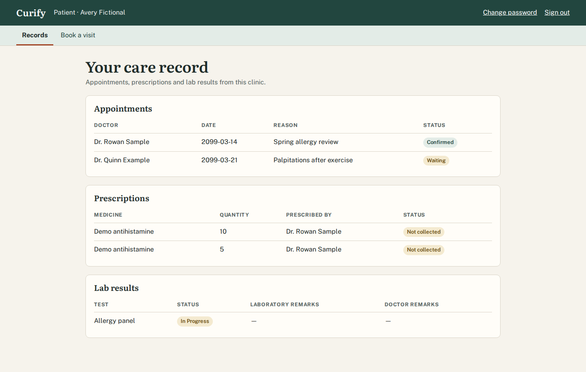
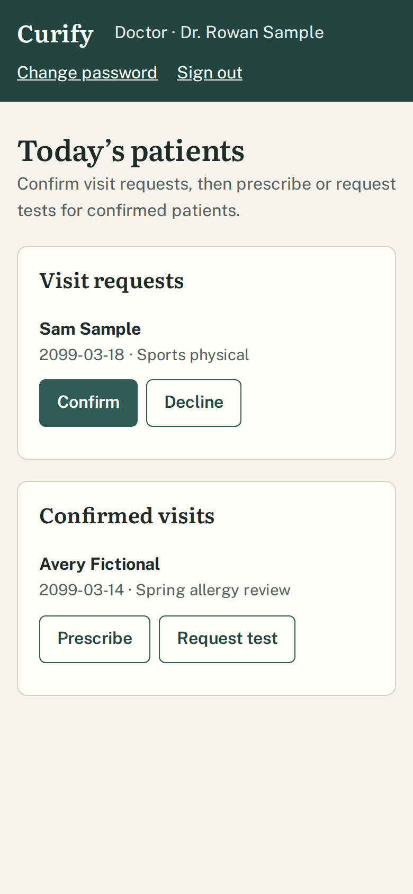

# Clinic Portal

A small clinic workflow built with React, Express and MongoDB. A patient requests an
appointment, the doctor confirms it and writes a prescription or requests a lab test, and an
administrator routes that work to a pharmacy or laboratory. Each role signs in to its own
workspace and sees only the records it needs for its step.



All names, conditions and records in the screenshots and the demo seed are invented.

## Who can do what

| Role | Can see and do |
| --- | --- |
| Patient | Request appointments; see their own appointments (waiting or confirmed), prescriptions and lab results |
| Doctor | Confirm or decline their own visit requests; prescribe and request tests only for patients with a confirmed visit |
| Laboratory | File results for test requests routed to that laboratory |
| Pharmacy | Dispense prescriptions routed to that pharmacy; record incoming stock |
| Administrator | Create, edit and delete accounts; route test requests and prescriptions |



## Design choices

- **Access is checked on the server, per request.** `backend/security/access.js` verifies the
  signed token, reloads the account, and pins every identity field in the request
  (`patientId`, `doctorId`, `LabId`, ...) to the signed-in user, so a client cannot act for
  someone else by editing a request body. It then checks relationships in the database: a
  doctor needs a confirmed appointment with a patient, and a lab or pharmacy needs the request
  to be routed to it.
- **Nothing is routed by guesswork.** New test requests and prescriptions start unassigned and
  are invisible to labs and pharmacies until the administrator routes them. Deleting a lab or
  pharmacy puts its open work back on the routing desk.
- **Dispensing is a MongoDB transaction.** The prescription is marked delivered and the stock
  is decremented together, guarded by `delivered: false` and `stock >= quantity`, so a double
  click or a retry cannot dispense twice. Transactions need MongoDB running as a replica set;
  Compose and the tests both do that.
- **Short sessions.** Tokens last 15 minutes. Changing a password (by the user or by the
  administrator) bumps a per-account `tokenVersion`, which invalidates every older token.
  Password hashes and `tokenVersion` are stripped from every JSON response by the models.
- **The browser only sends the token to the clinic API.** `frontend/src/api/session.js` keeps
  the session in `sessionStorage` and attaches it only to requests for the configured API.

## Run it with Docker Compose

Needs Docker with Compose v2.

```bash
cp .env.example .env
# Put a generated secret in .env:  JWT_SECRET=$(openssl rand -hex 32)
docker compose up --build -d
```

Create the first administrator, and optionally load the invented demo records (all demo
accounts share the `DEMO_PASSWORD` you choose):

```bash
docker compose exec -e BOOTSTRAP_ADMIN_EMAIL=admin@example.test \
  -e BOOTSTRAP_ADMIN_PASSWORD='choose-a-local-password' api node scripts/create-admin.js
docker compose exec -e DEMO_PASSWORD='choose-a-demo-password' api node scripts/seed-demo.js
```

Open http://localhost:4000 and sign in. The API listens on http://localhost:5100. Demo
accounts are `avery@demo.example.test` (patient), `rowan@demo.example.test` (doctor),
`lab@demo.example.test`, and `pharmacy@demo.example.test`.

Stop it with `docker compose down` (add `-v` to delete the database volume).

The browser bundle has the API address baked in at build time. To serve the portal from
another host, set `REACT_APP_API_URL` (the API as the browser will reach it) and
`WEB_ORIGIN` (the portal's own origin, allowed by the API's CORS check) before
`docker compose up --build`.

## Run it without Docker

Use Node 22 (`.nvmrc`) and MongoDB 7 started as a single-node replica set
(`mongod --replSet rs0`, then `rs.initiate()` once in `mongosh`).

```bash
npm ci
cp .env.example .env      # set MONGO_URI and JWT_SECRET
BOOTSTRAP_ADMIN_EMAIL=admin@example.test BOOTSTRAP_ADMIN_PASSWORD='choose-a-local-password' \
  node scripts/create-admin.js
DEMO_PASSWORD='choose-a-demo-password' npm run seed:demo   # optional
npm start                 # API on http://localhost:5000
```

In another terminal:

```bash
cd frontend
npm ci
REACT_APP_API_URL=http://localhost:5000 npm start   # Vite dev server on http://localhost:3000
```

## API

Every route except `/health` and `POST /api/<Role>/login` needs `Authorization: Bearer <token>`.
Request bodies wrap their fields in `data`. These exchanges were captured from the Compose
stack with the demo seed loaded (tokens shortened):

Sign in as the demo patient:

```http
POST /api/Patients/login
{"data": {"email": "avery@demo.example.test", "password": "<DEMO_PASSWORD>"}}
```

```json
200 OK
{
  "_id": "6af11f5acd9f19be3f43724a",
  "name": "Avery Fictional",
  "email": "avery@demo.example.test",
  "age": 41,
  "disease": "Seasonal allergy",
  "phoneNumber": "555-0100",
  "address": "12 Example Lane",
  "token": "eyJhbG…eaAo",
  "role": "patient"
}
```

List the patient's appointments, including requests the doctor has not confirmed yet:

```http
POST /api/Patients/getAllAppointments
Authorization: Bearer eyJhbG…eaAo
{"data": {}}
```

```json
200 OK
[
  {
    "_id": "6af11f5acd9f19be3f437258",
    "doctorId": "6af11f5acd9f19be3f437250",
    "patientId": "6af11f5acd9f19be3f43724a",
    "dateTime": "2099-03-14",
    "patientName": "Avery Fictional",
    "reason": "Spring allergy review",
    "doctorName": "Dr. Rowan Sample",
    "Accepted": true,
    "__v": 0
  },
  {
    "_id": "6af11f5acd9f19be3f43725b",
    "doctorId": "6af11f5acd9f19be3f437251",
    "patientId": "6af11f5acd9f19be3f43724a",
    "dateTime": "2099-03-21",
    "patientName": "Avery Fictional",
    "reason": "Palpitations after exercise",
    "doctorName": "Dr. Quinn Example",
    "Accepted": false,
    "__v": 0
  }
]
```

Asking for another patient's reports is refused, whatever id the body carries:

```http
POST /api/Patients/getMyReport
Authorization: Bearer eyJhbG…eaAo
{"data": {"patientId": "000000000000000000000000"}}
```

```json
403 Forbidden
{"error": "Access denied"}
```

A doctor with a confirmed visit prescribes; the new prescription is unassigned, so the
pharmacy cannot dispense it until the administrator routes it:

```http
POST /api/Doctors/addPrescription
Authorization: Bearer <doctor token>
{"data": {"Med": "Demo antihistamine", "quantity": 5, "patientId": "6af11f5acd9f19be3f43724a"}}
```

```json
201 Created
{
  "message": "Prescription added",
  "Prescription": {
    "doctorId": "6af11f5acd9f19be3f437250",
    "patientId": "6af11f5acd9f19be3f43724a",
    "Medicine": "Demo antihistamine",
    "Quantity": 5,
    "doctorName": "Dr. Rowan Sample",
    "delivered": false,
    "_id": "6af11f661cf2c76ddca04da6",
    "__v": 0
  }
}
```

```http
POST /api/Pharmacies/deliverMedicine
Authorization: Bearer <pharmacy token>
{"data": {"PresId": "6af11f661cf2c76ddca04da6"}}
```

```json
403 Forbidden
{"error": "Access denied"}
```

| Prefix | Notable routes |
| --- | --- |
| `/api/Patients` | `login`, `findbyID`, `doctors`, `addAppointment`, `getAllAppointments`, `myPrescription`, `getMyReport`, `changePass`, `PUT /:id` (own profile) |
| `/api/Doctors` | `login`, `getAllPendingAppointments`, `getAllAcceptedAppointments`, `acceptAppointments`, `rejectAppointments`, `addPrescription`, `addReport`, `getPatientReport`, `addReportRemarks` |
| `/api/Labs` | `login`, `getAllReport` (open), `getAllReportsLab`, `getAllReportsPatient?patientId=`, `addReportRemarks` |
| `/api/Pharmacies` | `login`, `patients`, `getClientPrescription`, `deliverMedicine`, `getAllMedicine`, `addMedicine` |
| `/api/Admin` | `login`, `add/update/del` + `Patient`/`Doctor`/`Lab`/`Pharmacy`, `getAll...`, `addAdmin`, `assignments`, `assignReport`, `assignPrescription` |

## Tests and checks

```bash
npm test            # API tests against a throwaway in-memory MongoDB replica set
cd frontend
npm test            # Vitest component and session tests
npm run lint
npm run build       # Vite production build into frontend/build
```

The API tests cover anonymous and cross-account access, doctor-patient relationships, lab and
pharmacy routing, account management, the booking flow, input validation, concurrent
dispensing and session invalidation. `mongodb-memory-server` downloads a `mongod` binary on
install; to use one you already have (for example copied out of the `mongo:7` image), set
`MONGOMS_SYSTEM_BINARY=/path/to/mongod` and `MONGOMS_VERSION` to its version.

## Screenshots

| Patient record | Doctor workspace (mobile) |
| --- | --- |
|  |  |

## Credentials in earlier history

An earlier version of this project committed MongoDB Atlas connection strings. They are not in
this repository's history, but whether they were revoked is unconfirmed; the account owner
should rotate them in Atlas. Never put real patient data in a demo deployment.

## License

MIT, see [LICENSE](LICENSE).
