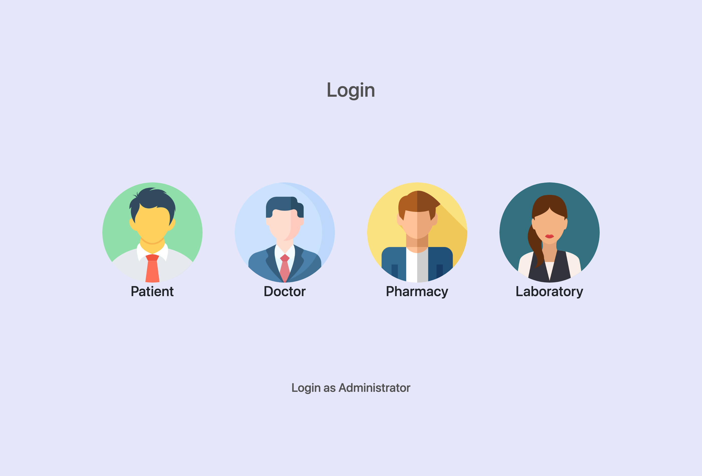

# Clinic Portal

A clinic management system with four roles: patients book appointments and read
reports, doctors write prescriptions, pharmacies dispense them, laboratories
file results. An administrator manages all four.

React, Express, MongoDB, Mongoose.



---

## ⚠️ Credentials were committed and pushed

**Read this first.** Two live MongoDB Atlas connection strings, complete with
usernames and passwords, are in this repository's git history:

```
mongodb+srv://Curify:<password>@cluster0.rgw1ren.mongodb.net/Curify
mongodb+srv://Test:<password>@cluster0.7sw7qbs.mongodb.net/Curify
```

`.env` was tracked, `.gitignore` never mentioned it, and the file was committed
with a populated value twice. The current `.env` is blank — but blanking a file
does not remove earlier versions from history, and this repository has a
GitHub remote.

**What was done here:** `.env` is untracked, `.gitignore` now excludes it, and
`.env.example` documents the variables.

**What that does not do:** it does not remove the passwords from history, and it
does not un-publish them. Atlas clusters are internet-facing.

**What actually fixes it,** in order:

1. **Rotate both database passwords in Atlas now,** or delete the clusters if
   they are no longer used. This is the only step that matters.
2. Check Atlas network access rules — a cluster open to `0.0.0.0/0` with a
   known password is reachable by anyone.
3. Optionally rewrite history (`git filter-repo`) and force-push. Do this
   *after* rotating, not instead of it: forks, clones and caches keep the old
   objects.

---

## Run it

```bash
cp .env.example .env      # the default points at the local Mongo
docker compose up -d --build
```

| | |
|---|---|
| Portal | http://localhost:4000 |
| API | http://localhost:5100 |

MongoDB runs in the compose stack; no Atlas account is needed.

---

## The password hash was in every response

Eight endpoints returned Mongoose documents straight to the client — login,
change-password, patient lookup by id and by email, and the admin listings —
and the schemas had no exclusion on the `password` field. Every one of those
responses carried the bcrypt hash to the browser.

bcrypt hashes are not reversible, but publishing them hands an attacker
unlimited offline attempts against whatever passwords are weak.

Two layers now stop it:

```js
password: { type: String, required: true, select: false }
```

keeps the hash out of any query that does not ask for it, and the login and
change-password paths ask explicitly with `.select('+password')`.

That alone was not enough. `addPatient` builds a document in memory
(`new Patient({...})`) and returns it — `select` never applied — and the login
path legitimately holds the hash and then returned the whole object. So the
schemas also carry:

```js
patientSchema.set("toJSON", {
  transform: (_doc, ret) => { delete ret.password; delete ret.__v; return ret; },
});
```

Serialisation is the one place that catches every route. Verified against the
running API: creating a patient and logging in both return
`['_id','address','age','disease','email','name','phoneNumber']` and no
`password`, and login still succeeds.

Credit where due: passwords were **already hashed with bcrypt** at 10 rounds,
and `changePass` verifies the old password before setting a new one. Those were
right.

---

## What was also wrong

**`node` was listed as a dependency** at `^20.0.0`. Node is the runtime; the
npm package of that name is not it.

**There was no README.** `readme.md` existed as a zero-byte file.

**There was no Dockerfile,** and the documented workflow assumed a MongoDB
Atlas cluster — the one whose password was committed.

---

## Known limitations

The honest list, and the first item is significant.

- **There is no authentication on any route.** Login verifies a password and
  returns a user object, but issues no token, and no route checks anything.
  `GET /api/Patients/findbyID`, `GET /api/Patients/findbyEmail` and
  `PUT /api/Patients/:id` will serve or modify any patient record to anyone who
  can reach the API. For a system holding medical data that is the defect that
  matters most, and fixing it properly means JWTs, middleware on all five
  routers, and ownership checks per record — a feature, not a patch, so it is
  documented rather than half-done.
- **CORS is wide open** (`app.use(cors())` with no origin restriction), which
  compounds the above.
- **No tests.**
- **No input validation** beyond Mongoose's `required`. Ages, phone numbers and
  emails are not checked.
- **Commit history contains messages** like `AlotofFuckingCode`, which are
  public on a public repository.
