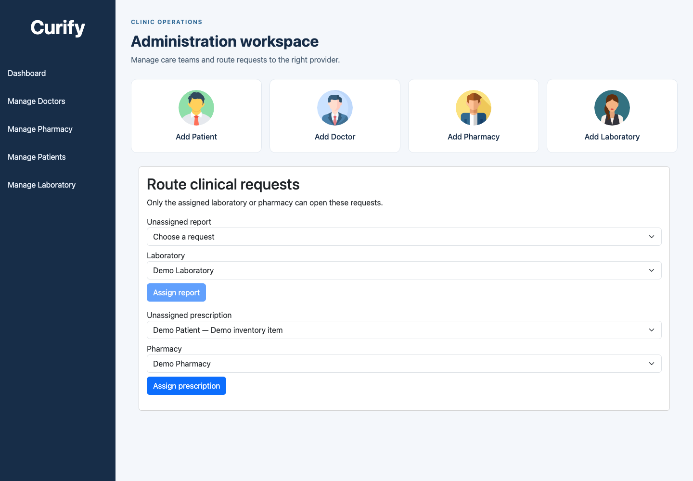
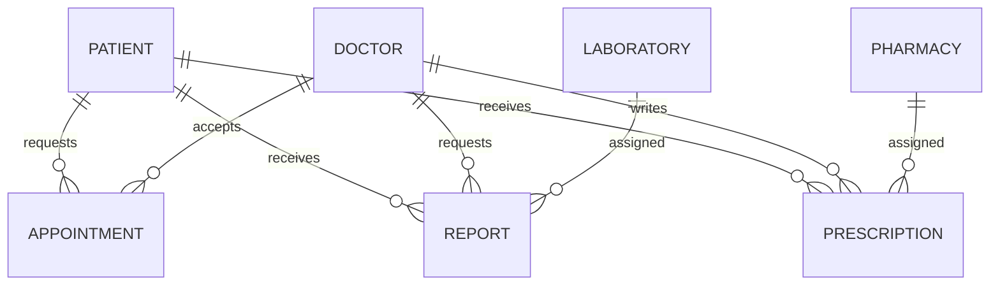

# Clinic Portal

A small clinic workflow built with React, Express and MongoDB: a patient requests an
appointment, the assigned doctor writes a prescription or requests a test, and an
administrator routes it to a pharmacy or laboratory. Each role sees the records it
needs for that step.



The screenshots use disposable accounts and synthetic records. A native browser check
signed in, assigned both kinds of request, refreshed the session, and verified that a
patient could not enter the administrator screen. [Mobile view](docs/screenshots/assignment-mobile.png).

## Who can do what

| Role | Access |
| --- | --- |
| Patient | Own appointments, prescriptions, reports and profile; a limited doctor directory |
| Doctor | Own appointments and patients linked by an accepted appointment |
| Laboratory | Requests explicitly assigned to that laboratory |
| Pharmacy | Prescriptions explicitly assigned to that pharmacy and its own stock |
| Administrator | Account management and explicit request assignment |



The API checks signed tokens and database relationships. Changing a password invalidates
older tokens. A pharmacy dispenses the prescription's recorded quantity in a MongoDB
transaction: concurrent retries cannot mark it delivered twice or decrement stock twice.
The browser sends authentication only to the configured API and clears its session on logout.
Tokens expire after 15 minutes; logout clears the browser session rather than revoking a
single token on the server.

## Try it locally

Use Node 22 and MongoDB 7 configured as a replica set. A single-node replica set is enough
for development; transactions require it. Start your own database, then:

```bash
npm ci
cp .env.example .env
# Set MONGO_URI for your database and JWT_SECRET from: openssl rand -hex 32
# One-time bootstrap, before an administrator exists:
BOOTSTRAP_ADMIN_EMAIL=admin@example.test BOOTSTRAP_ADMIN_PASSWORD='<choose a strong local password>' node scripts/create-admin.js
npm start
```

In another terminal:

```bash
cd frontend
npm ci
REACT_APP_API_URL=http://localhost:5000 npm start
```

Open http://localhost:3000, sign in as the administrator, and create accounts. The
assignment desk routes newly created reports and prescriptions. Existing unassigned
records remain inaccessible to labs and pharmacies until an administrator assigns them;
the app does not guess who should own old records.

A container path is also provided: set `JWT_SECRET` in `.env`, then run
`docker compose up --build`. It exposes the portal at http://localhost:4000 and the API
at http://localhost:5100. The replica-set container configuration has not been executed
here because this machine's Docker daemon is unavailable; native execution was verified.

## Checks

```bash
npm test                                   # isolated MongoDB replica-set HTTP tests
cd frontend
npm test -- --watchAll=false --runInBand     # browser-session tests
npx eslint src --ext .js,.jsx --max-warnings 0
npm run build
```

The database tests cover anonymous access, cross-patient attempts, doctor relationships,
lab/pharmacy assignments, concurrent dispensing and password-change session invalidation.
The test database is disposable and needs no Atlas account.

## Historical credential exposure

Two Atlas credentials were committed in older history. They are absent from current
tracked configuration, but their revocation is unconfirmed. The account owner must rotate
or revoke them in Atlas. Normal maintenance commits preserve history; a coordinated security
rewrite would be a separate operation, after revocation. Never use real patient data in a
public demo.
